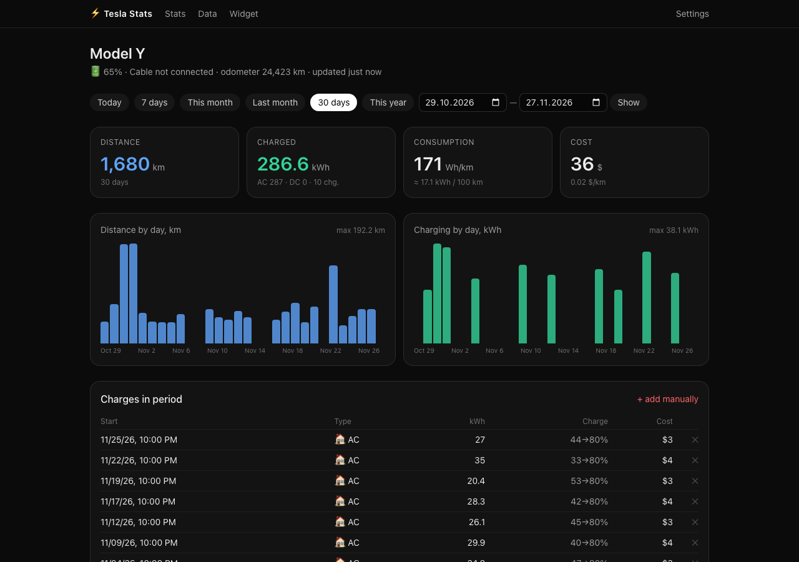
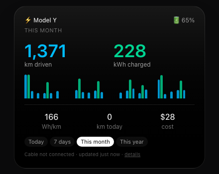
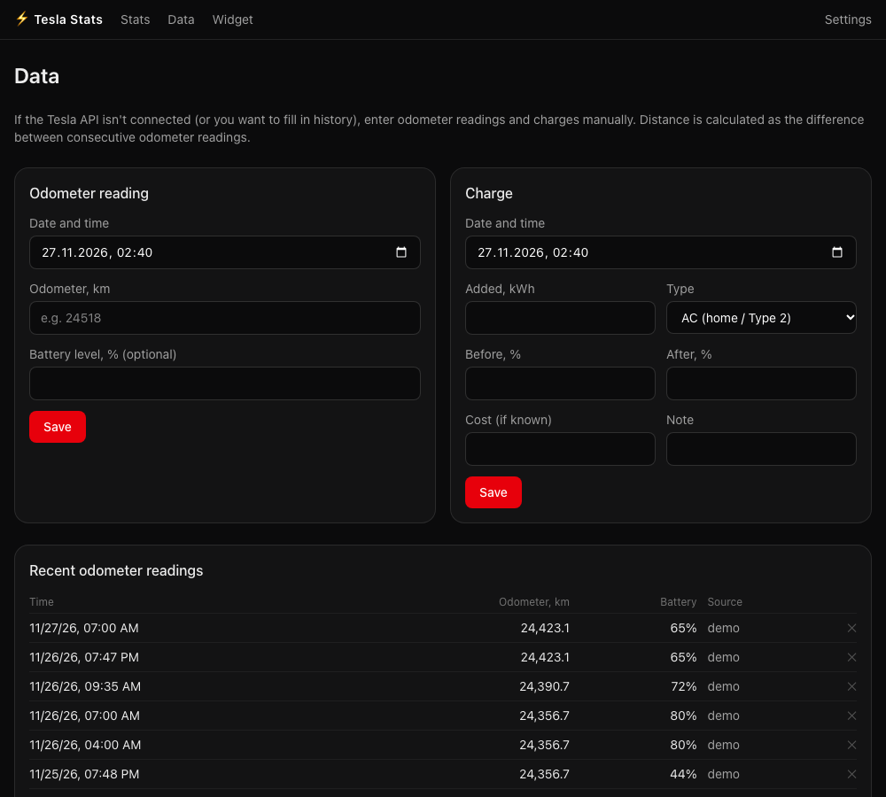
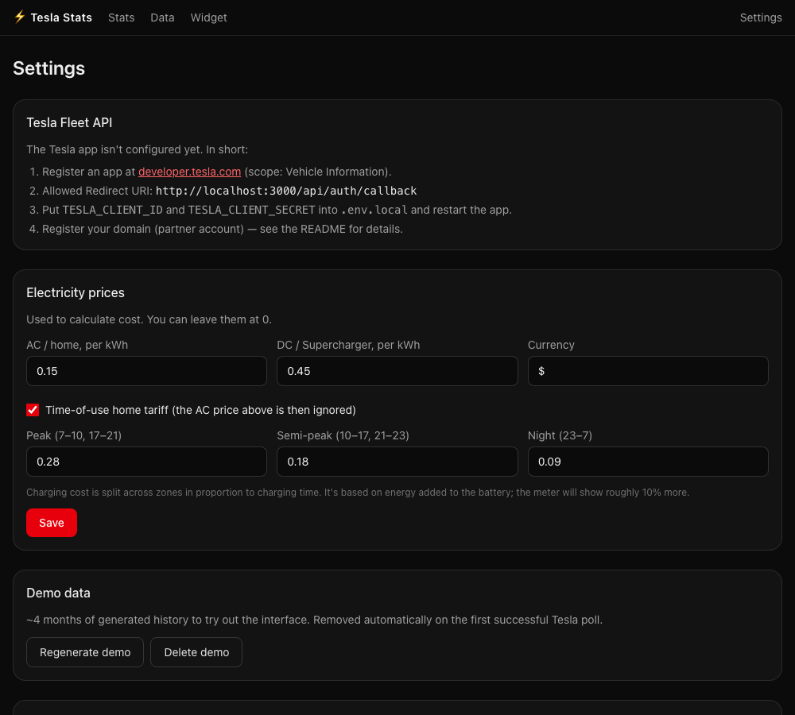

<div align="center">


# EV Stats for Tesla

**How far did I drive, and how much did I charge?** A self-hosted dashboard and widgets for your Tesla that answer that for any period, with data from the official Fleet API.

[](https://github.com/dream-x/tesla-stats/actions/workflows/ci.yml)
[](https://nextjs.org)
[](https://nodejs.org/api/sqlite.html)
[](#docker)
[](#macos-widget)
[](LICENSE)



</div>

## Features

- 📏 **Mileage**: distance driven, from odometer deltas, for today, 7/30 days, this or last month, the year, or any custom range.
- 🔌 **Charging**: sessions are detected automatically (AC at home or DC Supercharger), with kWh, state of charge before and after, and cost.
- 💸 **Costs**: Wh/km, cost per period and per km. Supports flat rates or **time-of-use** home tariffs (peak, semi-peak and night zones).
- 📊 **Charts**: daily bars, or monthly bars for long periods.
- 📱 **Widgets**: a PWA home-screen card, an iOS widget for [Scriptable](https://scriptable.app), a native **macOS WidgetKit** widget, and a JSON API for Home Assistant, KWGT and similar.
- 😴 **Never wakes the car**: a sleeping car is skipped, and no mileage is lost because the odometer doesn't move while it sleeps.
- 🩺 **Ops-ready**: `/api/health`, Prometheus `/api/metrics`, daily SQLite backups, and a Docker healthcheck.
- 🌍 **English and Russian UI** (`APP_LOCALE=en|ru`).
- 🗄️ **Zero external services**: one Node process with the built-in `node:sqlite` database.

<table>
<tr>
<td></td>
<td></td>
<td></td>
</tr>
<tr align="center"><td>Widget page</td><td>Charges & odometer</td><td>Settings & tariffs</td></tr>
</table>

## Quick start

Requires Node.js ≥ 22.13.

```bash
cp .env.example .env.local   # fill in later; not needed for the demo
npm install
npm run dev                  # http://localhost:3000
```

Click **Load demo** to explore the UI. Demo data is removed automatically after the first successful poll of a real car.

### Docker

```bash
docker compose up -d --build                  # data is stored in ./data
APP_LOCALE=ru docker compose up -d --build    # Russian UI
```

Set `TZ` in `.env.local`: it defines day and month boundaries.

## Connecting your Tesla (Fleet API)

Data comes from the official [Tesla Fleet API](https://developer.tesla.com/docs/fleet-api).

1. **Create an application** at <https://developer.tesla.com>.
   - Scopes: *Vehicle Information* and *Profile*.
   - Allowed Origin: your domain, plus `http://localhost:3000`.
   - Allowed Redirect URI: `http://localhost:3000/api/auth/callback` (Tesla allows plain HTTP for localhost only).
2. Put `TESLA_CLIENT_ID`, `TESLA_CLIENT_SECRET`, `TESLA_REDIRECT_URI` and the regional `TESLA_FLEET_API_BASE` into `.env.local`.
3. **Publish a public key.** Tesla requires one at `https://<your-domain>/.well-known/appspecific/com.tesla.3p.public-key.pem`:
   ```bash
   openssl ecparam -name prime256v1 -genkey -noout -out data/private-key.pem
   openssl ec -in data/private-key.pem -pubout -out data/public-key.pem
   ```
   The app serves `data/public-key.pem` (or `TESLA_PUBLIC_KEY`) at that path itself. Reading vehicle data doesn't need the private key; keep it safe.
4. **Register the partner domain** once. The domain must be reachable over HTTPS:
   ```bash
   node --env-file=.env.local scripts/register-partner.mjs your-domain.example
   ```
5. Open **Settings → Sign in with Tesla**. Polling then starts automatically.

> [!TIP]
> **No domain? Use GitHub Pages.** Tesla rejects `trycloudflare.com` and other proxy domains, and also rejects the word "tesla" in domains and paths.
> 1. Create a `<user>.github.io` repo holding only `.well-known/appspecific/com.tesla.3p.public-key.pem` and an empty `.nojekyll`.
> 2. In the Tesla app, use Origin `https://<user>.github.io` and Redirect `http://localhost:3000/api/auth/callback`.
> 3. Register `<user>.github.io` as the partner domain.
>
> The dashboard itself can stay on your LAN.

> [!NOTE]
> The Fleet API has **no history endpoint** for trips or odometer, so statistics start accumulating once you connect. Past data can be entered manually on the *Data* page.

### API costs

The Fleet API is paid, but Tesla includes a monthly free credit (≈ $10). The default polling uses a few thousand requests a month, which usually fits within that credit:
- every 10 minutes;
- every 2 minutes while driving or charging.

Tune it with `POLL_INTERVAL_MINUTES` and `POLL_ACTIVE_INTERVAL_MINUTES`.

## Widgets

### PWA / home screen
Open `/widget` in Safari or Chrome → Share → **Add to Home Screen**. The page refreshes itself every 5 minutes.

### iOS (Scriptable)
1. Paste `widgets/scriptable-tesla-stats.js` into [Scriptable](https://scriptable.app).
2. Set `BASE_URL` and `TOKEN`.
3. Use the widget parameter to choose the period: `today`, `7d`, `month`, `prev-month`, `30d` or `year`.

### macOS widget
A native WidgetKit widget for the desktop and Notification Center.

1. Install Xcode and `brew install xcodegen`.
2. Run `macos/build.sh`. It builds **EV Stats.app** into `~/Applications`, reading `WIDGET_TOKEN` and `WIDGET_BASE_URL` from `.env.local`.
3. Right-click the desktop → **Edit Widgets** → *EV Stats*.

### JSON API
- **`GET /api/summary?period=month`** (or `period=custom&from=2026-11-01&to=2026-11-15`) returns distance, kWh, Wh/km, cost and a daily series.
- **`POST /api/poll`** forces a poll. Use it for an external cron when the built-in poller is disabled with `DISABLE_POLLER=1`.

## Configuration

| Variable | Default | Description |
| --- | --- | --- |
| `TESLA_CLIENT_ID` / `TESLA_CLIENT_SECRET` | — | Fleet API application credentials |
| `TESLA_REDIRECT_URI` | `http://localhost:3000/api/auth/callback` | Must match the Tesla app |
| `TESLA_FLEET_API_BASE` | EU endpoint | `https://fleet-api.prd.{eu,na}.vn.cloud.tesla.com` |
| `TESLA_VIN` | first car | Pick a car if the account has several |
| `APP_LOCALE` | `en` | UI language, `en` or `ru`. Applied at build time: rebuild after changing it |
| `TZ` | system | Time zone for day and month boundaries |
| `DATABASE_PATH` | `./data/tesla.db` | SQLite file |
| `POLL_INTERVAL_MINUTES` / `POLL_ACTIVE_INTERVAL_MINUTES` | `10` / `2` | Polling cadence |
| `BASIC_AUTH_USER` / `BASIC_AUTH_PASSWORD` | — | Password-protect the whole UI |
| `WIDGET_TOKEN` | — | Token for `/api/summary`, `/api/poll` and `/widget` (`?token=` or `Authorization: Bearer`) |
| `BACKUP_DIR` / `BACKUP_KEEP` | — / `14` | Daily `VACUUM INTO` backups, keeping the newest N |

Tariffs (flat AC/DC prices or time-of-use zones) and the currency are configured in the UI.

## How the numbers are computed

- **Distance**: the sum of odometer increases between consecutive readings within the period.
- **Charged**: the increase of `charge_energy_added`, i.e. energy delivered to the battery. Wall energy is about 5–15 % higher because of charging losses. If the counter already holds a leftover from an earlier plug-in, only the new increase counts.
- **Consumption**: charged ÷ distance over the same period. It can be noisy over short periods.
- **Cost**: kWh × your AC/DC price, or the price of each time-of-use zone weighted by charging time. A cost entered manually on a charge takes precedence.

## Operations

- **`GET /api/health`**: JSON with DB status, age and status of the last Tesla poll, and backup age. No auth, no secrets.
- **`GET /api/metrics`**: Prometheus metrics (`tesla_stats_*`: odometer, SoC, range, charging, poll and backup counters). Don't expose it publicly.
- **Copying the live DB**: use only `sqlite3 data/tesla.db ".backup copy.db"`. The DB runs in WAL mode, and a plain `cp` can lose recent writes.
- **One poller only**: run a single instance per database. Tesla rotates refresh tokens, so a second poller would invalidate the first one's token.

## Security

If the app is reachable from the internet, set `BASIC_AUTH_USER`/`BASIC_AUTH_PASSWORD` and `WIDGET_TOKEN`. Tesla tokens are stored in the local SQLite database: protect `data/` and your backups.

## Development

```bash
npm run dev     # dev server
npm test        # stats and charge-detection tests
npm run lint
npm run build
```

Project layout:

| Path | Contents |
| --- | --- |
| `src/lib` | DB, Tesla client, poller and recorder, stats, i18n |
| `src/app/(main)` | Dashboard, data and settings pages |
| `src/app/widget` | Compact widget page |
| `src/app/api` | OAuth, JSON API, health and metrics |
| `macos/` | WidgetKit app |
| `widgets/` | Scriptable widget |

## Disclaimer

This is an independent project. It is not affiliated with, endorsed by, or sponsored by Tesla, Inc. "Tesla" is a trademark of Tesla, Inc.

## License

[MIT](LICENSE)
